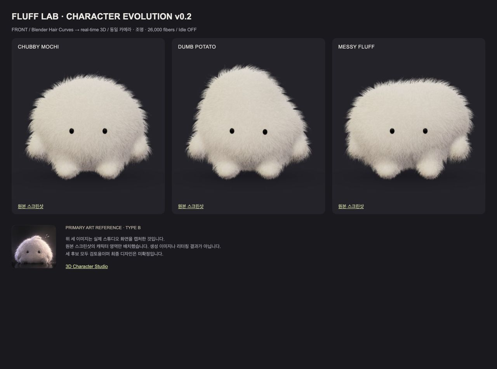
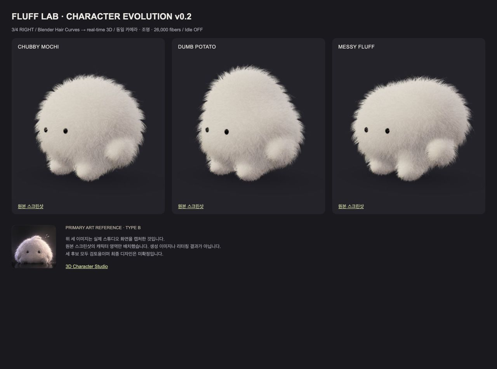

# FLUFF LAB — Character Evolution v0.2

2026-10-19 · 검토용 후보 / 최종 디자인 미승인

기존 개발용 스튜디오에서 세 후보를 실제 3D로 제작했다. 제품 UI와 앱 기능은 변경하지 않았다. Primary Visual Reference는 제공된 FLUFF LAB 보드의 두 번째 TYPE B이다. v0.1은 기술적 비교 기준이며 디자인 목표가 아니다.

## 실제 렌더링 비교

동일 조명·카메라·기본 눈 비율, Idle 정지 상태에서 촬영했다. 아래 보드는 실제 브라우저 캡처를 배치한 것이며 생성 이미지나 리터칭이 아니다.

[3/4 왼쪽](left-comparison.png) · [측면](side-comparison.png) · [후면](back-comparison.png) · [Clay](clay-comparison.png) · [Silhouette](silhouette-comparison.png) · [눈 비율 3종](face-comparison.png)

## 세 후보

| 후보 | 장점 | 남은 디자인 판단 |
|---|---|---|
| CHUBBY MOCHI | 낮고 둥근 중심, 안정적인 봉제 인형 비율 | 가장 순하지만 개성은 상대적으로 약하다 |
| DUMB POTATO | 위아래 비대칭과 어색한 비율이 멍한 인상을 만든다 | 윗부분이 달걀처럼 보일 수 있다 |
| MESSY FLUFF | 넓고 비대칭인 덩어리, 가장 독특한 실루엣 | 일부 각도에서 머리 윗부분이 넓고 평평하다 |

Neutral 눈은 균형적이고, Low / close는 더 멍하며, Wide / blank는 엉뚱한 인상이 강하다. 기본 화면의 MOCHI는 초기 표시값일 뿐 최종 선택이 아니다.

## 변경과 검수 중 수정

- 단일 구체를 대신해 몸통·팔 뿌리·발을 연속적인 SDF 표면으로 연결했다. 각 후보의 부피와 비대칭을 실제 geometry에 반영했다.
- 기존 26,000개 가이드를 유지하면서 undercoat 14,239개, curved overcoat 11,380개, flyaway 381개로 나눴다. 밀도 증가 대신 길이·뭉침·흐름을 조정했다.
- Blender Hair Curves와 Geometry Nodes 원본을 보존하고 실시간용 메시로 변환했다. 털 광학 normal을 보정하여 삼각 단면의 반짝임을 줄였다.
- 작은 검은 눈을 실제 표면 깊이에 배치하고 반사를 절제했다. 입·귀·꼬리는 추가하지 않았다.
- 첫 검수에서 MESSY의 오른발 연결이 끊기는 문제를 발견했다. 발 뿌리 볼륨을 이어 수정하고, 3/4에서 발이 길어 보이는 문제는 뒤쪽으로 옮겨 줄였다.
- 초기 털이 바깥으로 너무 서는 문제를 확인해 lift를 낮추고 정수리 흐름을 옆으로 눕혔다.
- 호흡·좌우 흔들림·느린 눈깜빡임·가끔의 전체 몸 기울임을 같은 pivot으로 묶었다. 프레임마다 React 상태를 갱신하지 않는다.
- 후보 전환 시 비활성 GPU geometry를 해제한다. 세 후보를 돌아본 뒤 다시 첫 후보를 표시하는 동작을 검증했다.
- 자유 회전 후 같은 카메라 프리셋을 다시 눌러도 해당 시점으로 돌아가도록 수정했다.

## 두 파이프라인과 커스터마이징 범위

A는 같은 표면에서 뽑은 가이드와 instanced crossed-ribbon shader를 사용한다. 형태·털 파라미터를 실시간으로 변경할 수 있다. B는 같은 가이드를 Blender 곡선으로 만들고 메시로 변환한다. 현재 비교의 기본값은 B이며 더 부드러운 곡선 볼륨을 제공하지만 비용과 파일 크기가 더 크다.

B의 몸·털은 베이크된 기본값이다. 눈 크기·간격·높이·깊이, roughness, lighting은 실시간 변경되며 몸과 털 변경은 재생성이 필요하다. 이를 숨기지 않고 해당 슬라이더를 비활성화했다. A 또는 Clay에서 형태를 실시간 검토할 수 있다.

[구조화된 후보 설정](presets.json) · [성능 원본](performance.json)

원본 및 실시간 자산:

- [MOCHI Blender](../../public/studio/v02/mochi/character-source.blend) / [GLB](../../public/studio/v02/mochi/character-b.glb)
- [POTATO Blender](../../public/studio/v02/potato/character-source.blend) / [GLB](../../public/studio/v02/potato/character-b.glb)
- [MESSY Blender](../../public/studio/v02/messy/character-source.blend) / [GLB](../../public/studio/v02/messy/character-b.glb)

Blender 원본에는 몸과 털이 있고 눈은 스튜디오에서 공유 3D 메시로 조립한다. 설정은 version 2 데이터로 저장하고 JSON으로 내보낼 수 있다. 기존 앱 저장 데이터는 유지했다.

## 성능

현재 Mac in-app browser, viewport 516×881, DPR 1.5, canvas buffer 735×855, Idle ON. 30프레임 준비 후 180프레임의 프레임 간격을 측정했다. GPU 실행시간 측정은 아니다.

| 파이프라인 | 중앙값 | p95 | 삼각형 | draw calls | GLB |
|---|---:|---:|---:|---:|---:|
| B MOCHI | 16.7ms | 18.0ms | 1,274,074 | 5 | 32.20 MiB |
| B POTATO | 16.7ms | 17.5ms | 1,274,618 | 5 | 32.25 MiB |
| B MESSY | 16.7ms | 18.7ms | 1,274,874 | 5 | 32.27 MiB |
| A MOCHI | 16.7ms | 18.6ms | 858,074 | 5 | — |

과거 v0.1 B는 1,275,138 triangles / 6 calls / 중앙값 16.7ms / p95 17.6ms / 30.57 MiB였다. A는 859,138 triangles / 6 calls / 중앙값 16.7ms / p95 17.5ms였다. 당시 viewport가 같지 않아 FPS 개선의 통제 실험으로 해석할 수 없다. 현재 삼각형 예산은 유사하며 GLB는 약 5–6% 커졌다.

후보 전환 후 활성 GPU geometry는 5개로 유지됐다. 실제 GPU 메모리 바이트는 UNKNOWN이다. 로더는 방문한 후보의 CPU 자산을 캐시하므로 세 후보를 모두 열면 약 97 MiB의 GLB를 로드한다.

## 실행한 검증

- TypeScript typecheck, Expo web export 성공.
- 기존 앱 tests/run.cjs와 studio 테스트 성공.
- 세 표면의 유한 좌표, 결정성, 서로 다른 geometry, 가이드 표면 일치, 눈 위치, 털 3계층 검증.
- 기본값 및 파라미터 경계값에서 팔다리를 포함해 하나의 연결된 표면인지 검증.
- 실제 브라우저에서 정면·좌우 3/4·측면·후면, Clay·Silhouette, 눈 3종, Idle, 후보 재선택, 파라미터 조작을 확인.
- 좁은 데스크톱 브라우저 폭 516px에서 확인했다. 실제 휴대폰 성능 검증은 아니다.

재생성: npm run studio:source → src/studio/build_blender.py로 각 .studio-build/{candidate}.json을 처리 → npm run build. 검증: npm run studio:test, npm test, npm run typecheck. Expo 호환 Node 24 환경에서 실행했다.

## 아직 목표와 차이가 있는 부분

레퍼런스의 길고 섬세하게 조형된 털 뭉침과 정수리 컬은 충분히 재현하지 못했다. 일부 외곽 잔털 끝도 날카롭다. 모발 산란·피하 산란과 접지 그림자는 근사 표현이며 실제 털 자체 그림자나 물리 시뮬레이션은 없다. MESSY의 평평한 상단, POTATO의 달걀형 상단은 사용자 취향 검토가 필요하다.

실제 모바일 GPU·장시간 발열·정확한 GPU 메모리·context-loss 복구는 미검증이다. 따라서 최종 작품 품질에 도달했다고 판정하지 않는다. 이번 산출물은 같은 조건에서 선택하고 다음 groom 조정을 결정할 수 있는 세 가지 실제 3D 후보이다.
